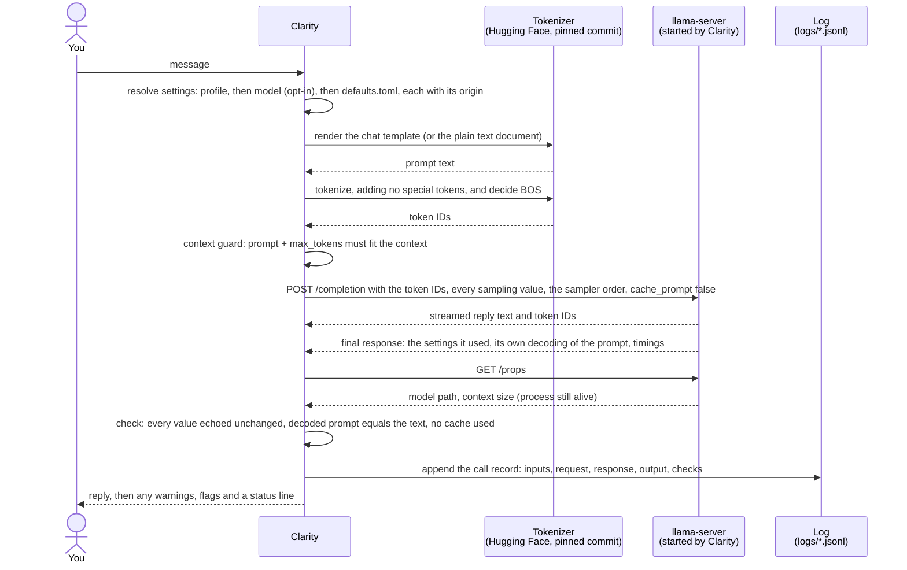

# Clarity

[](https://doi.org/10.5281/zenodo.24068236)

**Clarity**: a chat client for exact, replayable prompting experiments with local LLMs.

**What you see is exactly what the model got.**

## The problem

When you prompt a local model through a server or chat app, much of what shapes a reply is hidden:

- which chat template ran, and how the text was tokenized
- whether a beginning-of-sequence token was added
- sampler defaults from the server or from the model file, and samplers that were skipped silently
- prompt caching, and context shift dropping tokens
- flags picked up from environment variables or config files

So when two replies differ, you can't tell whether your prompt caused it, and you can't rerun the call to find out.

Clarity takes over that layer and shows it to you, without making experiments harder to run:

- it builds the prompt and its token IDs itself
- it sends every sampling value and checks that the server used them
- it logs every setting and environment fact known to affect the output
- it can re-send any completed call, and reports whether the output matched and what changed

## Reproducibility

The same call on the same machine and llama.cpp build gives the same output. Live tests check this for SmolLM2 and OLMo 3 on one Apple Silicon Mac, and it holds for the Transformers backend on MPS and CPU too. A different build, GPU, macOS version or batch setting can change the output, because GPU arithmetic depends on the order of operations. Clarity logs all of these, and `clarity replay` (or `/replay` in a chat) re-sends a call and lists any that differ. See [Design](docs/design.md#determinism-and-replay).

## Features

- Chat mode, through the model's chat template, and text mode, where the model continues a plain document.
- Branches in a chat (`/regen`, `/edit`, `/undo`), and marks and notes on replies, during a chat or afterwards.
- Replay of any completed call, with a list of everything recorded that changed since.
- Export of a conversation to one JSON Lines file a notebook can load, with exact token IDs, where each message sits in the prompt, and marks and notes.
- Blind batch runs for comparing setups.
- Models at a pinned commit: converted from the official weights, or a ready-made GGUF checked by sha256.
- A llama-server that Clarity starts and checks itself, and a Transformers backend that runs the same weights in-process (`uv sync --extra hf`).

## Quick start

Needs [uv](https://docs.astral.sh/uv/), CMake, a C++ compiler and a GPU that llama.cpp supports (or see [Getting started](docs/getting-started.md#before-you-begin) to run on the CPU). Live tests have run on Apple Silicon only; other GPUs are untested. Getting started also walks through these steps.

```
uv sync
git clone https://github.com/ggml-org/llama.cpp vendor/llama.cpp
git -C vendor/llama.cpp checkout f477f795cb071baf5b8af6488378366a72034ac4
cmake -S vendor/llama.cpp -B vendor/llama.cpp/build -DCMAKE_BUILD_TYPE=Release -DLLAMA_CURL=OFF
cmake --build vendor/llama.cpp/build --config Release -j 8 --target llama-server

uv run clarity fetch smollm2-135m-instruct   # download at the pinned commit, convert to GGUF
uv run clarity chat --profile smol-text      # chat; /help lists the commands
uv run clarity run --openings FILE --profiles smol-chat smol-text  # blind test; FILE holds openings separated by --- lines
uv run clarity replay logs/CONVERSATION_ID.jsonl CALL_ID           # re-send a call, compare
uv run clarity chats                                                # list your conversations
uv run clarity chat --json --profile smol-chat                     # chat from a script: JSON lines in and out
uv run clarity mark logs/CONVERSATION_ID.jsonl CALL_ID LABEL       # label a past reply
uv run clarity note logs/CONVERSATION_ID.jsonl CALL_ID "TEXT"      # add a note to a past reply
```

## Documentation

- [Getting started](docs/getting-started.md): from a fresh clone to a first chat and a first blind test.
- [Guides](docs/guides.md): write a profile, add a model, run a blind test, replay a call, read the logs, and fix common errors.
- [Reference](docs/reference.md): every command, profile key, setting, log record and flag.
- [Design](docs/design.md): the choices, their tradeoffs, and what is out of scope.
- [Contributing](CONTRIBUTING.md): tests, checks, how to add a backend, credit, and the release checklist.
- [Changelog](CHANGELOG.md) and [Roadmap](ROADMAP.md): what changed in each release, and what's next.

## Configuration

You set up every experiment in these files. Clarity doesn't edit the ones it ships; your own go in `local/`, which git ignores. What `fetch` resolves goes to `models.lock`; what each call resolves goes to its log.

- `models.toml`: the models, each pinned to a commit.
- `server.toml`: every llama-server flag.
- `defaults.toml`: the neutral value of every setting.
- `profiles/*.toml`: one experimental setup each (model, mode, prompt pieces and settings). Put your own in `local/profiles/`.

To use a model's own recommended sampling settings, add `use_recommended = true` to a profile. [Reference](docs/reference.md) lists every key.

## From profile to token IDs

Clarity builds every prompt itself. It resolves each setting and records where it came from, renders the chat template or a plain document, and tokenizes the text with the model's own tokenizer at its pinned commit. It sends the token IDs with every sampling value, and after the call checks that the server used exactly those. `/prompt` shows the text and IDs behind any reply, and `/prompt repr` makes whitespace visible.

One call on the llama.cpp backend, end to end:



The Transformers backend runs the model in-process instead of through llama-server, and checks its effective generation config after each call.

## What is logged, and why

Each conversation is one JSONL file in `logs/`, append-only. Every call writes a record, even when it fails or you cancel it, holding everything needed to reproduce it or explain a difference:

- the profile's full text and files, and every setting with its origin
- the prompt text, its token IDs and the BOS decision; the template's repo, commit and hash
- the request sent and the server's response, including the values it echoed and what wasn't applied
- the output text and token IDs, stop type, timings and any failed check
- the model file's sha256, the client's commit, and the library versions that render prompts

Each server start is logged once per file: its command line, `/props`, build, environment variables and machine. Turns, marks, notes and replays are their own records. Logs hold private conversations, so `logs/` and `runs/` are gitignored.

## License and citation

Clarity is licensed under Apache 2.0; see [`LICENSE`](LICENSE) and [`NOTICE`](NOTICE). The OLMo 3 tokenizer files in `tests/fixtures/` come from AllenAI under the same license.

To cite Clarity, use **Cite this repository** on its GitHub page, which reads [`CITATION.cff`](CITATION.cff). Each release is archived on Zenodo with its own DOI; [10.5281/zenodo.24068236](https://doi.org/10.5281/zenodo.24068236) covers all versions. For reproducible work, cite the DOI of the release you used.
