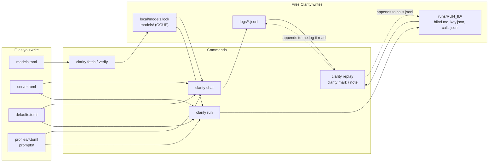

# Getting started

This tutorial takes you from nothing to a first chat. On a Mac with Apple silicon and 16 GB of memory or more, one command does the setup; everywhere else, or to make your own build, install by hand.

## Install with one command

On a Mac with Apple silicon and 16 GB of memory or more, paste this into Terminal:

```
curl --proto '=https' --tlsv1.2 -fsSL https://raw.githubusercontent.com/andalibmalit/clarity-chat/v0.4.5/install.sh | sh
```

In order, it:
1. Checks the Mac: Apple silicon, 16 GB of memory, and about 15 GB free in your home folder. It writes nothing until these pass.
2. Checks for Apple's command line tools, which bring git and the compiler. If they're missing, it opens Apple's installer and stops: click Install, then paste the command again.
3. Installs [uv](https://docs.astral.sh/uv/), which runs Clarity, if it's missing. It downloads uv's own installer at a pinned version, checks its sha256, then runs it. uv's installer puts `uv` in `~/.local/bin` and, by default, adds that folder to `PATH` in your shell's profile files: `~/.profile`; `~/.bashrc`, `~/.bash_profile` and `~/.bash_login` if they exist; one zsh file, `~/.zshrc` by default; and a file in fish's `conf.d`.
4. Puts Clarity in `~/Clarity`, at this release's tag. If `~/Clarity` exists and isn't Clarity, it stops and leaves it alone.
5. Runs `clarity setup`, which asks once, with the sizes, before it downloads anything: about 7.5 GB to download and 9.7 GB to keep. With uv, Python and Clarity, the whole install keeps about 10 GB. It then fetches llama.cpp's source at the pinned commit, builds `llama-server` (a few minutes), fetches Gemma 4 E4B and bge-m3 (the model meaning search uses), and puts `Clarity.command` on your Desktop.
6. Opens Clarity in your browser.

Most of the time goes to the build and the downloads. uv's installer and git get only your `HOME` and `PATH` from it, so proxy settings don't reach them: behind a proxy, install by hand. uv and setup also get `HF_HOME`, `HF_HUB_CACHE`, `HUGGINGFACE_HUB_CACHE` and `XDG_CACHE_HOME`, if your shell sets them, so the models go where Clarity, started from your shell, looks for them. Set them in your shell profile, not only in this Terminal window: the launcher opens a new window, which reads only the profile, so it would look for the models somewhere else.

The models go in the Hugging Face cache (`~/.cache/huggingface`, unless your shell sets `HF_HOME`, `HF_HUB_CACHE`, `HUGGINGFACE_HUB_CACHE` or `XDG_CACHE_HOME`) and in `~/Clarity/models/`; the converter's Python environment goes in `~/Clarity/models/.converter`. uv keeps its cache in `~/.cache/uv` (under `XDG_CACHE_HOME`, if your shell sets it), and the Python it installs in `~/.local/share/uv/python`. If those variables put the cache on another disk, neither the install's check of free space (in your home folder) nor setup's (on the disk Clarity is on) looks at that disk: either can stop for space the models won't use, and neither notices a cache disk that's too full. From then on, double-click `Clarity.command` on your Desktop to start Clarity. Paste the command again at any time: each step that's already done says so, and it does only what's missing, including after an interruption.

To read the script before it runs, download it, read it, then run it:

```
curl --proto '=https' --tlsv1.2 -fsSL -o install.sh https://raw.githubusercontent.com/andalibmalit/clarity-chat/v0.4.5/install.sh
sh install.sh
```

## Move to a new release

Your chats, documents and models stay when you move `~/Clarity` to a new release. They live in its `logs/`, `runs/`, `local/` and `models/` folders, which git ignores, so moving leaves them alone. Don't delete `~/Clarity` to install again: that deletes them too.

For a release that moves neither llama.cpp's pinned commit nor a model's conversion, quit Clarity, then run these lines in Terminal, with the new release's tag in place of `vX.Y.Z`:

```
cd ~/Clarity
git fetch --depth 1 origin tag vX.Y.Z
git checkout vX.Y.Z
uv sync --locked --inexact --no-dev --group setup
```

The release's entry in `CHANGELOG.md` says if it moves either. Such a release needs more than these steps: llama.cpp built again at the new commit, or the model converted again. Clarity is planned to do that for you from 0.8.0.

## Install by hand

For Linux, an Intel Mac or a Mac with less than 16 GB of memory, or to make your own build. This takes you from a fresh clone to a first chat and a first blind test, using SmolLM2-135M-Instruct, a tiny model that downloads in a minute. It takes about 20 minutes, most of it building llama.cpp.

### Before you begin

You need:
- [uv](https://docs.astral.sh/uv/), CMake and a C++ compiler.
- About 2 GB of disk for llama.cpp, SmolLM2 and the converter's own Python environment. The OLMo 3 models used later take about 58 GB more, and the Llama 3.1 8B models about 64 GB.
- A GPU that llama.cpp supports. `server.toml` puts every layer on the GPU, and Clarity stops if the model lands on the CPU instead. To run on the CPU, set `n-gpu-layers = 0` in `server.toml`.

Clarity's live tests have run on Apple Silicon (Metal), and CI runs the SmolLM2 live tests on a Linux CPU build. Its offline tests run on macOS, Linux and Windows.

## Install Clarity and build llama.cpp

1. Install the Python dependencies:

   ```
   uv sync
   ```

2. Clone llama.cpp into `vendor/` and check out the commit pinned in `server.toml`:

   ```
   git clone https://github.com/ggml-org/llama.cpp vendor/llama.cpp
   git -C vendor/llama.cpp checkout b1b770d90d94cad9e9ea5b993bdbc383a522fb28
   ```

   Clarity refuses to start the server if the checkout is at another commit, because a different build can give different output. If the checkout is right but the built `llama-server` comes from another commit, Clarity stops and asks you to rebuild it.

3. Build `llama-server`:

   ```
   cmake -S vendor/llama.cpp -B vendor/llama.cpp/build -DCMAKE_BUILD_TYPE=Release -DLLAMA_CURL=OFF -DLLAMA_USE_PREBUILT_UI=OFF
   cmake --build vendor/llama.cpp/build --config Release -j 8 --target llama-server
   ```

   On macOS this builds with Metal. For other GPUs, see llama.cpp's own build guide, `vendor/llama.cpp/docs/build.md`.

## Fetch a model

```
uv run clarity fetch smollm2-135m-instruct
```

This downloads the model from Hugging Face at the commit pinned in `models.toml`, converts it to a bf16 GGUF in `models/smollm2-135m-instruct/`, and records its sha256 and everything else it resolved in `local/models.lock`.

To check the file later, re-hash it:

```
uv run clarity verify smollm2-135m-instruct
```

```
ok    smollm2-135m-instruct: sha256 matches (0f049d7126689b64…)
```

A chat that searches your documents finds the parts closest in meaning to your message, with a second model, bge-m3. Fetch it too: a 2.27 GB download, and about 3.4 GB kept (the download stays in the Hugging Face cache).

```
uv run clarity fetch bge-m3
```

## Have a first chat

1. Start a chat with the `smol-chat` profile:

   ```
   uv run clarity chat --profile smol-chat
   ```

   Clarity starts its own llama-server, checks it, and prints the conversation ID:

   ```
   Starting profile smol-chat …
   Ready: smollm2-135m-instruct (chat mode), conversation 20261108-220704-a2dc64. /help for commands.
   ```

   The conversation's log is `logs/CONVERSATION_ID.jsonl`, here `logs/20261108-220704-a2dc64.jsonl`.

2. Type a message and press Enter. Alt+Enter, or Esc then Enter, starts a new line. The reply streams in, followed by a status line with the stop reason, the reply length in tokens, the time, the seed, how much of the context the conversation uses, and the call ID:

   ```
   > hello world!
   Hello world!
   [stop eos · 4 tokens · 0.1 s · seed 42 · context 31 of 8,192 · call-e32b57a3e5e4]
   ```

3. See exactly what the model got:

   ```
   > /prompt
   --- prompt: 23 tokens; no BOS prepended (chat mode: the template writes any BOS; Hugging Face adds none) ---
   <|im_start|>system
   You are a helpful assistant.<|im_end|>
   <|im_start|>user
   hello world!<|im_end|>
   <|im_start|>assistant

   --- token IDs (23) ---
   [1, 9690, 198, 2683, 359, 253, 5356, 11173, 30, 2, 198, 1, 4093, 198, 28120, 905, 17, 2, 198, 1, 520, 9531, 198]
   ```

   This is the prompt text after the chat template ran, the BOS decision, and the token IDs that were sent. `/prompt repr` shows the same text with every space and newline visible.

4. See every setting and where it came from:

   ```
   > /settings
   profile smol-chat (chat mode, model smollm2-135m-instruct)
     temperature        0.6                                          profile
     top_k              0                                            profile
     …
     repeat_last_n      64                                           default
     …
   backend llama.cpp: fixed values for its other sampling fields
     dynatemp_range = 0.0
     …
   ```

   Each value is marked `profile` (set in `profiles/smol-chat.toml`) or `default` (from `defaults.toml`). Below them are the fixed values Clarity sends for llama-server's other sampling fields, so none of the server's own defaults apply.

5. Get a different reply to the same message:

   ```
   > /regen
   Hello world!
   [stop eos · 4 tokens · 0.0 s · seed 43 (regen) · call-2a2abdb31d5f]
   ```

   The new reply uses the first reply's seed plus 1, so it's a new sample that can still be replayed. Here a tiny model happened to give the same text. Both replies stay in the log.

6. Check that the reply reproduces:

   ```
   > /replay
   Identical: same output token IDs and stop type. (replay-0eef9facb182)
   Nothing recorded differs: build, flags, /props, environment, machine, model file, client.
   ```

   Clarity re-sent the call exactly as logged and compared the output token by token. If anything recorded had differed, such as the llama.cpp build or a server flag, it would be listed here.

7. Label the reply for later, then quit:

   ```
   > /mark landed
   Marked call-2a2abdb31d5f.
   > /quit
   ```

`/help` lists every command. [Chat commands](reference.md#chat-commands) in the reference describes each one.

## Chat in the browser

The web interface runs the same chats in a page on your computer. Everything it does to a chat goes through the same commands as the terminal, and into the same log. The page is tested in Chrome on every change. Automated tests also run it in Firefox and in WebKit, the engine Safari uses; those runs don't block a change yet, so a problem there can slip through.

1. Start it:

   ```
   uv run clarity ui
   ```

   ```
   Clarity is at http://127.0.0.1:8765/#key=…
   (the link works until Clarity stops). Enter opens it again; Ctrl-C stops Clarity.
   Keep this window open while you use Clarity.
   ```

   Clarity opens the page in your browser. The link holds a secret made for this start, so only someone with the link can use Clarity. One tab at a time can use it.

2. In **Choose a profile to start**, pick `smol-chat`. The page says "Starting smol-chat…" while the model starts, then shows the profile, the model and its backend.

3. Type a message and press Enter. Shift+Enter starts a new line. The reply appears as it's written, and **Stop** keeps the part that arrived. Under the reply are **Copy**, **Regenerate**, **Replies** and **Details**. **Details** shows exactly what the model got, as text and as token IDs, how the reply stopped, the settings as logged, and **Replay**.

4. **Settings**, under the message box, lists every setting with its value and where it came from. A change applies from the next reply and is logged with it.

5. **Chats**, the tab on the left edge, lists your chats under Today and Earlier. Pick one to reopen it as it was logged; the page says what differs today.

6. To quit, choose **Quit Clarity** from the **Clarity** menu, or press Ctrl-C in the terminal. Your chats stay in `logs/`.

[The web interface](reference.md#the-web-interface) in the reference describes each part of the page.

## Look at the log

Every call wrote a record to `logs/CONVERSATION_ID.jsonl`, with everything needed to reproduce it or explain a difference. [Log records](reference.md#log-records) lists what's in it.

To list the replies in a conversation with [jq](https://jqlang.org/):

```
jq -c 'select(.type == "call") | {call_id, stop_type, output_text}' logs/CONVERSATION_ID.jsonl
```

`logs/` is gitignored, because it holds your conversations.

## Run a first blind test

A blind test sends the same openings to several profiles and gives you the replies shuffled and unlabelled, so you can rate them without knowing which setup wrote which.

1. Write two openings to a file, separated by a line that is exactly `---`:

   ```
   Write one sentence about the sea.
   ---
   Name three uses for a paperclip.
   ```

   Save it as `openings.txt`.

2. Send them to two profiles. `smol-chat` uses the model's chat template; `smol-text` has the same model continue a plain document instead:

   ```
   uv run clarity run --openings openings.txt --profiles smol-chat smol-text
   ```

   The terminal shows progress only, never the replies:

   ```
   Run 20261108-220743-a82d31: 4 calls.
   4/4
   Done. Share /path/to/clarity-chat/runs/20261108-220743-a82d31/blind.md.
   Keep /path/to/clarity-chat/runs/20261108-220743-a82d31/key.json closed until rating is done.
   ```

3. Open `runs/RUN_ID/blind.md`. Each opening is followed by its replies, labelled A, B and so on, each with empty `Rating:` and `Note:` lines to fill in.

4. When you've rated every reply, open `runs/RUN_ID/key.json` to see which label came from which profile. The calls themselves are in `runs/RUN_ID/calls.jsonl`.

## How the files fit together

Clarity reads the files you write and never edits the ones it ships; your own profiles go in `local/profiles/`. What it resolves and records goes into files of its own:



## Next steps

- Write your own profile: see [Write a profile](guides.md#write-a-profile).
- Fetch the OLMo 3 models (`uv run clarity fetch olmo-3-7b-instruct`, then `olmo-3-7b-base`) and try the four OLMo 3 profiles in `profiles/`: `1a-stock` (no system message, so OLMo 3's template writes its own), `1b-blank` (a blank one, so none), `4-raw-instruct` (the instruct model continuing a plain document) and `5-raw-base` (the base model on the same document).
- Fetch Llama 3.1 8B (`llama-3.1-8b-instruct` and `llama-3.1-8b-base`). Meta gates its repos, so accept the licence and log in first: see [Fetch a gated model](guides.md#fetch-a-gated-model). Then try `llama-3.1-8b-chat` and `llama-3.1-8b-base`. Llama's chat template starts every chat with a system header that says today is 26 Jul 2024, even with no system message of yours. That date is the template's fixed default, not today's, so a chat renders the same tokens on any day. `/prompt` shows it.
- Read [Design](design.md) for why Clarity works the way it does.
