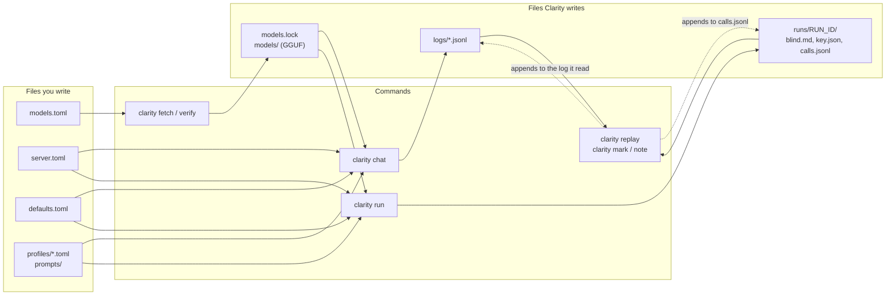

# Getting started

This tutorial takes you from a fresh clone to a first chat and a first blind test, using SmolLM2-135M-Instruct, a tiny model that downloads in a minute. It takes about 20 minutes, most of it building llama.cpp.

## Before you begin

You need:
- [uv](https://docs.astral.sh/uv/), CMake and a C++ compiler.
- About 2 GB of disk for llama.cpp, SmolLM2 and the converter's own Python environment. The OLMo 3 models used later take about 58 GB more.
- A GPU that llama.cpp supports. `server.toml` puts every layer on the GPU, and Clarity stops if the model lands on the CPU instead. To run on the CPU, set `n-gpu-layers = 0` in `server.toml`.

Clarity's live tests have run on Apple Silicon (Metal) only. Its offline tests run on macOS, Linux and Windows.

## Install Clarity and build llama.cpp

1. Install the Python dependencies:

   ```
   uv sync
   ```

2. Clone llama.cpp into `vendor/` and check out the commit pinned in `server.toml`:

   ```
   git clone https://github.com/ggml-org/llama.cpp vendor/llama.cpp
   git -C vendor/llama.cpp checkout f477f795cb071baf5b8af6488378366a72034ac4
   ```

   Clarity refuses to start the server if the checkout is at another commit, because a different build can give different output. If the checkout is right but the built `llama-server` comes from another commit, Clarity stops and asks you to rebuild it.

3. Build `llama-server`:

   ```
   cmake -S vendor/llama.cpp -B vendor/llama.cpp/build -DCMAKE_BUILD_TYPE=Release -DLLAMA_CURL=OFF
   cmake --build vendor/llama.cpp/build --config Release -j 8 --target llama-server
   ```

   On macOS this builds with Metal. For other GPUs, see llama.cpp's own build guide, `vendor/llama.cpp/docs/build.md`.

## Fetch a model

```
uv run clarity fetch smollm2-135m-instruct
```

This downloads the model from Hugging Face at the commit pinned in `models.toml`, converts it to a bf16 GGUF in `models/smollm2-135m-instruct/`, and records its sha256 and everything else it resolved in `models.lock`.

To check the file later, re-hash it:

```
uv run clarity verify smollm2-135m-instruct
```

```
ok    smollm2-135m-instruct: sha256 matches (0f049d7126689b64…)
```

## Have a first chat

1. Start a chat with the `smol-chat` profile:

   ```
   uv run clarity chat --profile smol-chat
   ```

   Clarity starts its own llama-server, checks it, and prints the conversation ID:

   ```
   Starting profile smol-chat …
   Ready: smollm2-135m-instruct (chat mode), conversation 20261108-220704-a2dc64. /help for commands.
   ```

   The conversation's log is `logs/CONVERSATION_ID.jsonl`, here `logs/20261108-220704-a2dc64.jsonl`.

2. Type a message and press Enter. Alt+Enter, or Esc then Enter, starts a new line. The reply streams in, followed by a status line with the stop reason, the reply length in tokens, the time, the seed, how much of the context the conversation uses, and the call ID:

   ```
   > hello world!
   Hello world!
   [stop eos · 4 tokens · 0.1 s · seed 42 · context 31 of 8,192 · call-e32b57a3e5e4]
   ```

3. See exactly what the model got:

   ```
   > /prompt
   --- prompt: 23 tokens; no BOS prepended (chat mode: the template writes any BOS; Hugging Face adds none) ---
   <|im_start|>system
   You are a helpful assistant.<|im_end|>
   <|im_start|>user
   hello world!<|im_end|>
   <|im_start|>assistant

   --- token IDs (23) ---
   [1, 9690, 198, 2683, 359, 253, 5356, 11173, 30, 2, 198, 1, 4093, 198, 28120, 905, 17, 2, 198, 1, 520, 9531, 198]
   ```

   This is the prompt text after the chat template ran, the BOS decision, and the token IDs that were sent. `/prompt repr` shows the same text with every space and newline visible.

4. See every setting and where it came from:

   ```
   > /settings
   profile smol-chat (chat mode, model smollm2-135m-instruct)
     temperature        0.6                                          profile
     top_k              0                                            profile
     …
     repeat_last_n      64                                           default
     …
   backend llama.cpp: fixed values for its other sampling fields
     dynatemp_range = 0.0
     …
   ```

   Each value is marked `profile` (set in `profiles/smol-chat.toml`) or `default` (from `defaults.toml`). Below them are the fixed values Clarity sends for llama-server's other sampling fields, so none of the server's own defaults apply.

5. Get a different reply to the same message:

   ```
   > /regen
   Hello world!
   [stop eos · 4 tokens · 0.0 s · seed 43 (regen) · call-2a2abdb31d5f]
   ```

   The new reply uses the first reply's seed plus 1, so it's a new sample that can still be replayed. Here a tiny model happened to give the same text. Both replies stay in the log.

6. Check that the reply reproduces:

   ```
   > /replay
   Identical: same output token IDs and stop type. (replay-0eef9facb182)
   Nothing recorded differs: build, flags, /props, environment, machine, model file, client.
   ```

   Clarity re-sent the call exactly as logged and compared the output token by token. If anything recorded had differed, such as the llama.cpp build or a server flag, it would be listed here.

7. Label the reply for later, then quit:

   ```
   > /mark landed
   Marked call-2a2abdb31d5f.
   > /quit
   ```

`/help` lists every command. [Chat commands](reference.md#chat-commands) in the reference describes each one.

## Look at the log

Every call wrote a record to `logs/CONVERSATION_ID.jsonl`, with everything needed to reproduce it or explain a difference. [Log records](reference.md#log-records) lists what's in it.

To list the replies in a conversation with [jq](https://jqlang.org/):

```
jq -c 'select(.type == "call") | {call_id, stop_type, output_text}' logs/CONVERSATION_ID.jsonl
```

`logs/` is gitignored, because it holds your conversations.

## Run a first blind test

A blind test sends the same openings to several profiles and gives you the replies shuffled and unlabelled, so you can rate them without knowing which setup wrote which.

1. Write two openings to a file, separated by a line that is exactly `---`:

   ```
   Write one sentence about the sea.
   ---
   Name three uses for a paperclip.
   ```

   Save it as `openings.txt`.

2. Send them to two profiles. `smol-chat` uses the model's chat template; `smol-text` has the same model continue a plain document instead:

   ```
   uv run clarity run --openings openings.txt --profiles smol-chat smol-text
   ```

   The terminal shows progress only, never the replies:

   ```
   Run 20261108-220743-a82d31: 4 calls.
   4/4
   Done. Share /path/to/clarity-chat/runs/20261108-220743-a82d31/blind.md.
   Keep /path/to/clarity-chat/runs/20261108-220743-a82d31/key.json closed until rating is done.
   ```

3. Open `runs/RUN_ID/blind.md`. Each opening is followed by its replies, labelled A, B and so on, each with empty `Rating:` and `Note:` lines to fill in.

4. When you've rated every reply, open `runs/RUN_ID/key.json` to see which label came from which profile. The calls themselves are in `runs/RUN_ID/calls.jsonl`.

## How the files fit together

Clarity reads the files you write and never edits the ones it ships; your own profiles go in `local/profiles/`. What it resolves and records goes into files of its own:



## Next steps

- Write your own profile: see [Write a profile](guides.md#write-a-profile).
- Fetch the OLMo 3 models (`uv run clarity fetch olmo-3-7b-instruct`, then `olmo-3-7b-base`) and try the four OLMo 3 profiles in `profiles/`: `1a-stock` (no system message, so OLMo 3's template writes its own), `1b-blank` (a blank one, so none), `4-raw-instruct` (the instruct model continuing a plain document) and `5-raw-base` (the base model on the same document).
- Read [Design](design.md) for why Clarity works the way it does.
